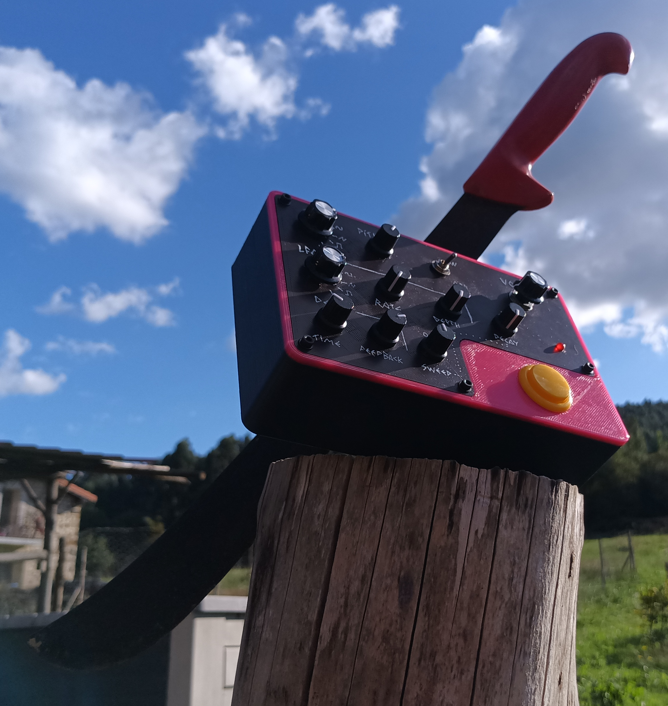

# SIRENITO

```
  ___(_)_ __ ___ _ __ (_) |_ ___
 / __| | '__/ _ \ '_ \| | __/ _ \
 \__ \ | | |  __/ | | | | || (_) |
 |___/_|_|  \___|_| |_|_|\__\___/
```

 El Sirenito es un sinte tipo DUB Siren.
 Funciona como instrumento stand-alone y controlador MIDI.
 Tambien hemos desarollado un VST (solo para MacOS y en version beta) 
 que emula el funcionamiento del HW para poder utilizarlo con
 tu DAW favorito si no te sobran las entradas de linea.

<p align="center">
  
</p>

## CARACTERÍSTICAS

AUDIO
- 4 tipos de onda: seno, sierra, cuadrada y laser.
- 4 LFO: seno, sierra, cuadrada y off.
- 8 potes: Pitch, Rate, Depth, Decay, Sweep, Delay Time, Feedback, Volume.
- Envolvente rápida con decay de 0,05 a 4s.
- Sweep de ±1200 Hz.
- Delay de hasta 1,2s con feedback, filtro y bypass.
- Salida I2S a 44,1 kHz / 16 bits, mono en L y R.

CONTROL
- Trigger por pulsador, con LED.
- Dos selectores de 4 posiciones: tipo de onda y LFO.
- USB-MIDI class-compliant, sin drivers.
- Nota 60 para trigger y CC 20-29 para los parámetros.
- El firmware envía MIDI, no recibe.

PLUGIN VST2
- macOS Intel (hecho pensando en nuestro Macbook del 2012).
- Mismo motor DSP que el firmware.
- Mismos controles que la versión física.
- Responde a nota 60 y CC 20-29.

ALIMENTACIÓN
- Pila de 9V con interruptor y regulador a 5V.
- También por USB.

## CÓMO SUENA

La onda la genera el ESP32. El LFO la mueve, el Trigger abre la envolvente
y el Sweep le pega el bajón. El Delay va al final, con Feedback y filtro.
En modo laser, Rate marca la cadencia y Decay la caída.

## HARDWARE

- ESP32-S3 DevKit N16R8 con USB OTG.
- PCM5102A.
- 8 potenciómetros lineales de 10k.
- 2 selectores rotativos de 4 posiciones.
- 1 pulsador NA.
- 1 LED + resistencia de 330 ohm.
- Pila de 9V, interruptor y regulador a 5V.
- Jack de 3,5 mm.

## ESQUEMA

### Alimentación

      +---------+    +-------------+    +--------------+
      | pila 9V |----| interruptor |----| regulador 5V |----+----> ESP32 5V
      +---------+    +-------------+    +--------------+    |
           |                                                +----> PCM5102A VIN
           |
           +------------------------------------------------------> GND común


    El USB OTG es el mismo puerto que usa para MIDI y para alimentar la placa.
    No hay una entrada de alimentación adicional. La DevKit tiene dos USB,
    usa el OTG. El otro es UART y no lleva MIDI.

    Usa pila o USB, no las dos a la vez. Con USB deja el interruptor en OFF.
    Regulador y pila van a GND común.

### Conexiones

                           +--------------------+
        Pitch     -------->| GPIO15             |
        Rate      -------->| GPIO18             |
        Depth     -------->| GPIO17             |
        Decay     -------->| GPIO16             |
        Delay     -------->| GPIO13             |
        Feedback  -------->| GPIO14             |
        Sweep     -------->| GPIO1              |
        Volume    -------->| GPIO2              |
                           |                    |
        Onda      -------->| GPIO4/5/6/7        |
        LFO       -------->| GPIO9/10/11/12     |
        Trigger   -------->| GPIO42             |
        LED       <--------| GPIO38             |---[330R]---|>|--- GND
                           |                    |
                           |             GPIO39 |---- BCK ----> DAC
                           |             GPIO40 |---- LRCK ---> DAC
                           |             GPIO41 |---- DIN ----> DAC
                           |                    |
                           |             3V3    |----> potes + XSMT
                           |             5V     |----> VIN del DAC
                           |             GND    |----> masa común
                           +--------------------+

    PCM5102A
      BCK  <- GPIO39      SCK  -> GND
      LRCK <- GPIO40      FMT  -> GND
      DIN  <- GPIO41      DEMP -> GND
      XSMT <- 3V3         FLT  -> GND
      VIN  <- 5V          OUT L/R -> jack 3,5 mm
      GND  <- masa común

    Cada pote: extremos a 3V3 y GND, wiper al GPIO.
    Los selectores y el pulsador cierran a GND. El firmware usa pull-up interno.

## MIDI

    Nota 60  Trigger

    CC 20  Pitch        CC 24  Delay Time
    CC 21  Rate         CC 25  Feedback
    CC 22  Depth        CC 26  Sweep
    CC 23  Decay        CC 27  Volume
    CC 28  Waveform     CC 29  LFO

    CC 28: 0 seno, 42 sierra, 84 cuadrada, 127 laser.
    CC 29: 0 seno, 42 sierra, 84 cuadrada, 127 off.

## CONTROLES

    Pitch     80-1200 Hz
    Rate      1-12 Hz
    Depth     0-100 %
    Decay     0,05-4 s
    Delay     0-1,2 s
    Feedback  0-92 %
    Sweep     -1200 a +1200 Hz
    Volume    0-100 %
